An unofficial NeoForge 1.21.1 backport of [joshxviii/plants-and-zombies](https://github.com/joshxviii/plants-and-zombies), following upstream's main branch at `bbf9ae9a`. MPL-2.0, like the original. All pictures are from this build.

**At a glance:** a treasure-dropping plant, three new raid bosses, flying Zombats, Zombie Goats, the Coffin, Door Shields, the Baron's Staff, Boss Chance in raids, a `/pz` command and an in-game options screen.

> **Updating an existing world?** Back it up first. Zombie Bats are replaced by Zombats, so saved Zombie Bats and their eggs are lost.

---

## 🌼 New plant: Marigold

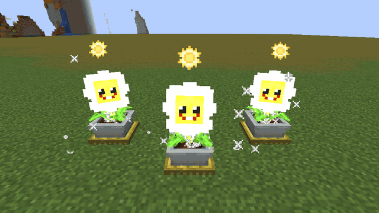

- **Drops treasure** instead of a seed packet when you grow it: diamonds, emeralds, gold ingots and sometimes a Golden Garden Gnome.
- **How to get it:** seed packets come from raid rewards.
- **How to grow it:** plant it on farmland or a Zen Plant Pot, water it, then feed it 32 sun.

---

## 🧟 New bosses and zombies

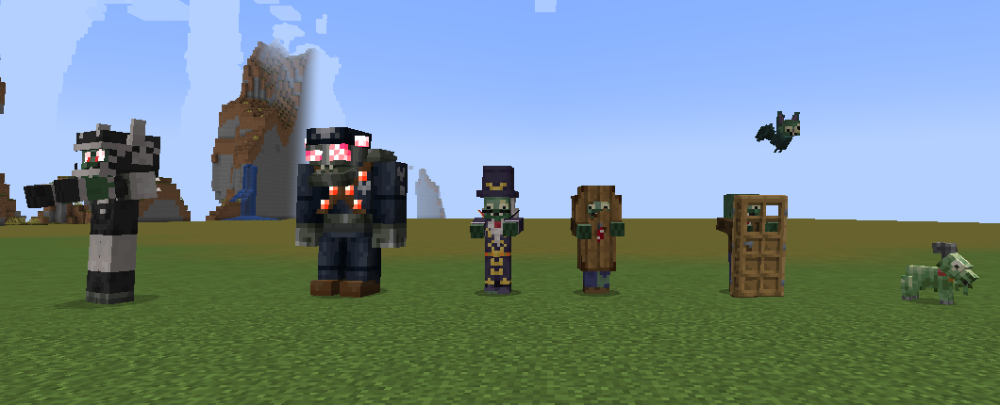

*Left to right: Giga-Football Zombie, Robo-General, Baron Von Bats, Coffin Zombie, Screen Door Zombie, Zombat (flying) and Zombie Goat.*

### Baron Von Bats

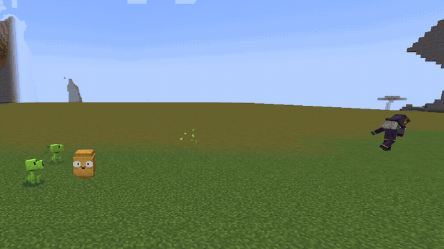

A new raid boss. He keeps his distance, teleports away when you get close, fires a beam from his staff, summons Vampire Zombies and can turn into a swarm of bats.

### More new mobs

| Mob | What it does |
|---|---|
| **Giga-Football Zombie** | A bigger, tougher All-Star variant that can spawn as a raid boss |
| **Robo-General** | A Robo-Zombie variant that can spawn as a raid boss |
| **Zombat** | Flies, and heals itself when it hurts other mobs. Replaces the Zombie Bat |
| **Zombie Goat** | A small new zombie with its own spawn egg |
| **Zombies with new gear** | Browncoats and raid zombies can now spawn carrying a Door Shield or wearing a Coffin |

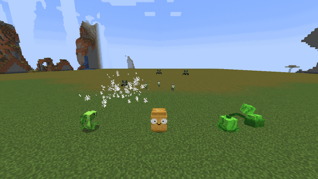

---

## 🛡️ New gear

### Door Shield

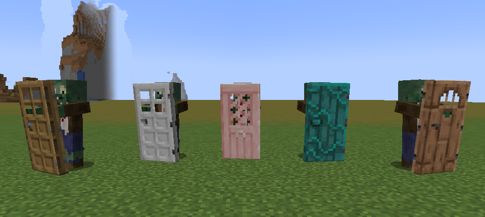

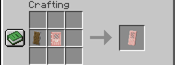

- **Recipe:** a shield plus **any door**. The shield looks like the door you used.
- Blocks like a shield, adds 2 armor while held, has 336 durability and can be enchanted.

### Coffin

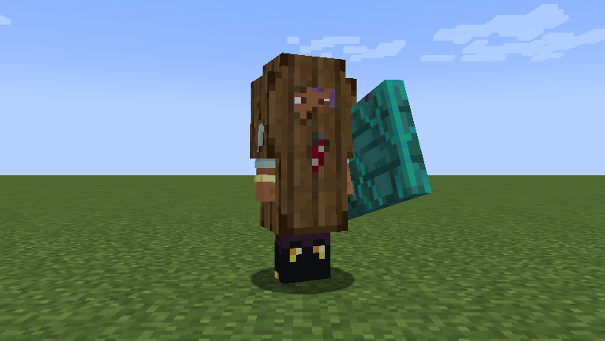

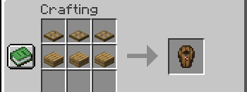

- **Recipe:** 3 wooden trapdoors above 3 wooden slabs. Any wood works.
- Worn in the chest slot, it **blocks direct attacks from every side**.
- Has 80 durability, can be repaired with planks and can be enchanted.

### Baron's Staff

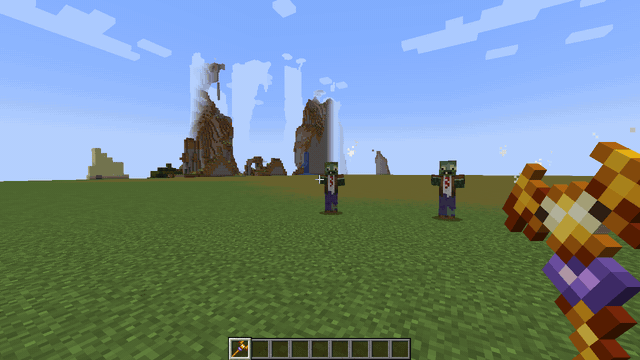

- **How to get it:** an 8% drop from Baron Von Bats. It drops partly damaged.
- Hold use to fire a beam: 14 blocks of range, 7 damage, and it hits everything in the line.
- Has 560 durability and a 1 second cooldown, and can be enchanted.

### Changes to protective gear

- Head protection (cones, buckets and football helmets) now takes the whole hit from above, with no hurt sound.
- The Newspaper blocks from a wider angle.
- Tooltips now show break chance and what each item blocks.

---

## ⚔️ Bigger raids

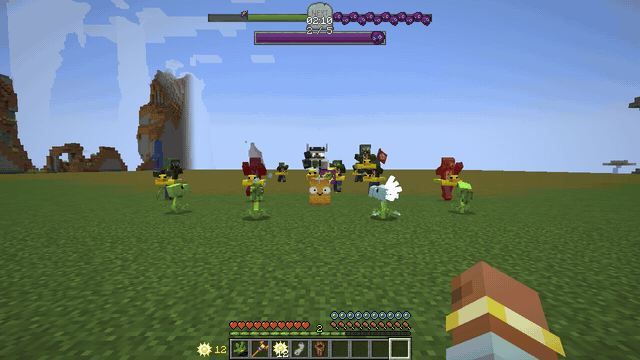

- **Boss Chance:** the odds that the next wave brings a boss. They grow every wave and reset once a boss spawns.
- **Five boss types:** Giga-Football Zombie, Baron Von Bats, Gargantuar, Robo-General and Zomboss, each tied to a range of waves.
- **Hero bonus rewards** now come from each boss wave instead of every 5 waves.
- **New raid messages and sound:** a boss spawn sound with a subtitle, "A boss has spawned", "Final Wave!" and "The Boss was defeated!".
- **Hold Tab for raid details:**

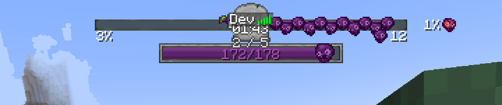

### New advancements

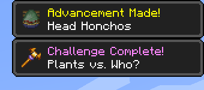

| Advancement | Goal |
|---|---|
| **Head Honchos** (new) | Defeat a Robo-General, Baron Von Bats and a Gargantuar |
| **Plants vs. Who?** (new) | Defeat 30 bosses |
| **Taco Time!** (changed) | Now: defeat 2 bosses |

---

## 🖥️ Menus, HUD and commands

### Options screen

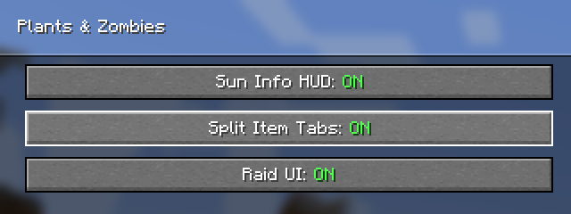

Open it with `/pz options`.

| Option | What it does |
|---|---|
| **Sun Info HUD** (off by default) | Shows your total sun, and the cost of a seed packet when you select it |
| **Split Item Tabs** (off by default) | Splits the creative tab into items, seed packets and zombies |
| **Raid UI** (on by default) | Shows or hides the raid overlay |

### Sun Info HUD

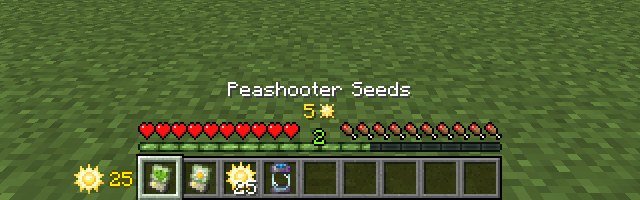

### Creative tabs and spawn eggs

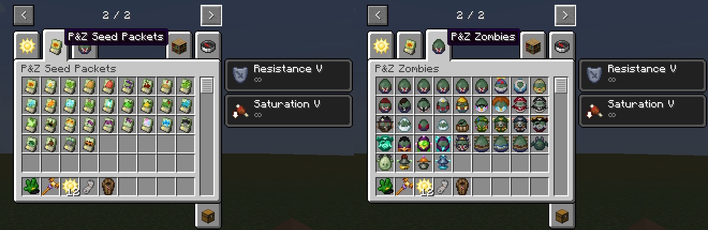

Variants and loadouts now have their own named spawn eggs and icons:

| Group | Spawn eggs |
|---|---|
| **Browncoat variants** | Balloon Zombie, Snowcoat, Desert Zombie, Buccaneer, Vampire Zombie |
| **Browncoat loadouts** | Conehead, Buckethead, Screen Door, Coffin, Fully Armored |
| **Imps** | Yeti Imp, Pirate Imp |
| **Gargantuars** | Pirate Gargantuar, Giga-Gargantuar |
| **Super Brainz** | Toxic Super Brainz, Electro Super Brainz |
| **Bosses** | Giga-Football Zombie, Robo-General |
| **Other new eggs** | Zombie Drone, Zombie Turret, Electro Turret, Pirate Captain Ghost, Zombat, Zombie Goat |

### `/pz` command

| Command | What it does | Who can use it |
|---|---|---|
| `/pz help` | Posts the Discord link in chat | Everyone |
| `/pz options` | Opens the options screen | Everyone |
| `/pz raid start [waves]` | Starts a raid near a flag, with an optional wave count | Operators |
| `/pz raid stop` | Stops the nearby raid | Operators |
| `/pz raid wave_start [wave] [boss]` | Starts the next wave now, with an optional wave type and boss | Operators |

---

## 🔧 Smaller changes

- Death messages now name the killer, including for the new "pierced" and "vaporized by" deaths.
- The Ducky Tube has a tooltip.
- **For pack makers:** `plantz:stored_sun` has a new `capacity` field, and seed mutation files can use a loot table as their result.

## 🐛 Fixes

- Raids saved by older versions keep loading, so existing worlds keep their raids.
- Hypnotized zombies fight other zombies again.
- Leader zombies no longer spawn extra zombies that never despawn.
- Fixed Pirate Captain Ghost and graveyard spawning.
- Fixed spawn eggs that pointed at missing textures, and the Pirate Captain Ghost egg's missing name.
- **Brazilian Portuguese:** official PvZ names are back after the 1.5.2 update replaced some of them, and the new mobs are named too.

---

## Before you update

- **Zombie Bats become Zombats under a new id, with no automatic conversion.** Zombie Bats and their spawn eggs saved in a world are gone after the update. Spawn a Zombat instead.
- Back up your world before updating.

## Install

Needed on both the server and the client. Put the jar in `mods/` together with:

- Kotlin for Forge 5.11.0 or newer
- TerraBlender 4.1.0.x for NeoForge 1.21.1

**Optional, detected automatically:** Iris, Vanilla Backport, Copper Age Backport (0.1.5+) and Backported Spears. See the [README](https://github.com/CoolFreeze23/plants-and-zombies-neoforge#readme) for what each one adds.

## Notes

- 26.1 baby armor textures and a few 26.1 sounds are read from a local 26.1+ Minecraft install when there is one. The mod doesn't ship Mojang's files.
- 149 GameTests pass with and without the optional mods.
